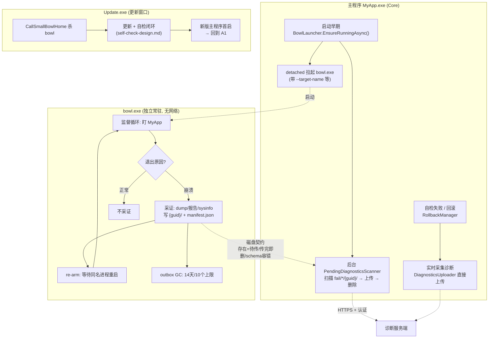

# Bowl 重设计方案：启动机制 + 诊断上报 + 独立控制台程序化

> **配套文档：** [self-check-design.md](self-check-design.md)（自检与回滚）。本方案在其基础上重新设计 Bowl 的启动机制与诊断上报机制，并给出把 Bowl 做成**独立安装的控制台程序**的改造清单。
>
> **解读约定：** 文中"独立的安装控制台程序"指一个独立分发、独立安装（不随主程序更新被替换）、以控制台形态运行的常驻看门狗程序 `bowl.exe`。

---

## 目录

1. [定位与设计目标](#1-定位与设计目标)
2. [启动机制重设计](#2-启动机制重设计)
3. [诊断上报机制重设计](#3-诊断上报机制重设计)
4. [独立控制台程序改造清单](#4-独立控制台程序改造清单)
5. [与 Core 的联动全景](#5-与-core-的联动全景)
6. [兼容与迁移](#6-兼容与迁移)
7. [实施分期](#7-实施分期)

---

## 1. 定位与设计目标

### 1.1 Bowl 的新定位

收敛为**崩溃诊断采证器（watchdog + outbox writer）**：

```
┌─ Bowl v2 职责 ──────────────────────────┐   ┌─ 移出 Bowl 的职责 ─────────────────┐
│ • 监控目标进程（全生命周期，可跨重启重挂） │   │ • 恢复备份（→ Core RollbackManager）│
│ • 崩溃采证：dump / 崩溃报告 / 系统信息    │   │ • 版本回滚决策（→ Core）            │
│ • 采证落盘（outbox）+ 磁盘 GC            │   │ • 网络上报（→ Core 单一出口）        │
│ • re-arm：目标重启后自动重新挂监控        │   │ • UpgradeFail 标记（→ Core）        │
└─────────────────────────────────────────┘   └────────────────────────────────────┘
```

原则：**Bowl 无网络、无回滚决策；它与外界的全部契约 = 一组命令行参数 + 一个磁盘目录结构。**

### 1.2 设计目标

| 目标 | 针对的现状缺口 |
|------|---------------|
| 全生命周期监控 | 现状只在"更新后那一次运行"有 Bowl；主程序重启后无人守护 |
| 启动时传参 | 现状 `Process.Start(bowlAppPath)` 无参数，目标靠 Bowl 宿主自己猜 |
| 谁启动都行、启动重复无害 | 现状只有 updater 一个启动者、无单实例保护 |
| 主程序崩溃后证据必达服务端 | 现状采证只落盘，无人上报；Core 上报但不知道 Bowl 存在 |
| 独立安装、独立演进 | 现状 exe 放在应用安装目录，随应用更新被替换 |

---

## 2. 启动机制重设计

### 2.1 启动时机与启动者（三入口收敛为主入口）

```
主入口（唯一必需）：主程序启动时自拉起
  MyApp.Main() 早期 → BowlLauncher.EnsureRunningAsync()（异步、best-effort、不阻塞启动）

辅入口（可选保留）：updater 自检通过后拉起
  仅当用户未在主程序内接入 EnsureRunning 时的兼容路径，默认关闭

管理入口（运维）：手动 / 开机自启
  bowl.exe watch（无参数 → 读 bowl.json 默认配置）
```

**为什么主入口改成主程序自己：**

1. 只有主程序启动入口能覆盖"没有更新发生的那一天"——这正是现状最大缺口。
2. 自检设计（self-check-design.md）中 updater 已接管更新边界的裁决，updater 不再需要拉 Bowl；两者分工变为：**自检管更新后前 30 秒，Bowl 管其余全部生命周期**，衔接无缝（主程序首启成功 → 自检通过 → 主程序第一件事就是把 Bowl 拉起来）。
3. updater 启动 Bowl 的旧路径（`WindowsStrategy.StartAppAsync` 的 `LaunchBowl` 分支）标记废弃、默认不再执行，`WindowsStrategy` 代码保留一个版本周期。

### 2.2 命令行参数契约（Core → Bowl 的唯一耦合面）

```
bowl.exe watch
  --target-name MyApp              # 监控目标进程名（必填，与 InstallPath 联合构成单实例键）
  --install-path D:\apps\MyApp     # 被监控应用安装目录（outbox 根 = {install-path}/fail/）
  --version 1.0.2                  # 被监控应用版本（fail 子目录名 + 报告字段）
  --schema 2                       # 契约版本号（Core 升级时可协商）
  [--bowl-home D:\GeneralUpdate\bowl]  # Bowl 自身安装目录（日志、工具缓存放这里，不污染应用目录）
  [--dump-type Mini|Heap|Full]     # 默认 Mini（Full 体积≈进程内存，须显式指定）
  [--idle-exit 00:30:00]           # 目标持续不出现的最长等待，超时自动退出（默认 30 分钟）
  [--config D:\...\bowl.json]      # 配置文件兜底（开机自启场景无参数启动）
  [--on-crash <command>]           # 高级钩子：崩溃后执行外部命令（替代原 AutoRestore，
                                   #   想自动回滚的用户自己配 restore 脚本，风险自负）
  [--log-level Information]
```

配置优先级：**命令行 > bowl.json > 内置默认**。所有参数与 `BowlContext` 字段一一对应，`BowlContext` 由 CLI 层装配——"宿主自己知道监控谁"的隐式约定从此消失。

### 2.3 生命周期：从"一次性监控"到"监督循环"

现状 `BowlBootstrap.LaunchAsync` 是一次性：拉 procdump → 等它退出 → 处理结果 → 结束。目标进程重启后监控就断了。新设计在控制台层加**监督循环**（类库 `LaunchAsync` 保持单次语义不动，可测试性不受影响）：

```
bowl.exe watch 启动
  │
  ├─ 获取单实例锁（Windows: named mutex / Unix: lock file）
  │    锁键 = hash(target-name + install-path)；已被持有 → exit 2（已在运行，正常退出）
  │
  └─ 监督循环：
       1. 按 target-name 找目标进程
          ├─ 不存在 → 等待 5s 重试；累计超过 idle-exit → 退出（防孤儿常驻占资源）
          └─ 存在 → 进入步骤 2
       2. 挂监控（平台 watcher，见 4.4），阻塞等待目标退出
       3. 目标退出后判定：
          ├─ 崩溃（非正常退出）→ 采证 → 落盘 outbox → [可选 on-crash 钩子]
          └─ 正常退出 → 不采证
       4. 回到 1（同名新进程出现 = 用户重启了应用 → 自动重新挂监控）
```

要点：

- **detached 启动**：主程序 `Process.Start(bowl.exe, args)` 后不持有句柄（`UseShellExecute=true` / Unix 下 .NET 子进程本就不随父退出），主程序崩溃时 Bowl 存活——watchdog 的硬要求。
- **正常退出不采证**：现状 procdump `-e` 只抓异常，但监督循环的退出码判定补上了"无 dump 也知道是不是崩溃"这一层（ExitCodeWatcher 兜底，见 4.4）。
- **单实例 + re-arm** 解决了"重复启动无害"和"主程序反复重启"两个问题；`idle-exit` 让"开机自启但用户没开应用"的常驻不空耗资源。

### 2.4 更新协同（时序不变，归属微调）

```
更新开始      CallSmallBowlHomeAsync 按 --target-name 杀掉 Bowl（现有逻辑不变）
更新完成      updater 自检闭环（self-check-design.md）
新版首启      主程序 → EnsureRunningAsync 重新拉起 Bowl（监督循环自动挂上新版进程）
```

Bowl 独立安装后**不被应用更新触碰**，杀掉-重启的节奏不变；`UpdateConfiguration.Bowl` 字段语义收敛为"要杀的进程名"（见 4.6）。

---

## 3. 诊断上报机制重设计

### 3.1 角色与数据流

```
┌──────────────┐ 采证落盘   ┌────────────────────────────┐  扫描+上传   ┌────────┐
│ bowl.exe     │ ────────→ │ {install-path}/fail/{ver}/ │ ←────────── │ 服务端  │
│ (无网络)      │           │        {guid}/ outbox      │  Core 唯一   └────────┘
└──────────────┘           └────────────────────────────┘  网络出口
                                                     ↑
                                    触发① 主程序启动，后台扫描补传
                                    触发② updater 自检失败/回滚，实时采集上传（不走 outbox）
```

**Core 是唯一网络出口**（复用 `HttpClientProvider` + `IHttpAuthProvider` 认证 + 上报容错惯例），Bowl 保持零网络依赖；两者的唯一联动 = 磁盘契约，无 IPC、无共享状态、无运行时协调。

### 3.2 Outbox 目录契约（v2 schema）

```
{install-path}/fail/{version}/
  └─ {guid}/                        # 一次崩溃采证一个目录，GUID 为服务端幂等键
       manifest.json                # ↓ 见下
       {version}_fail.dmp           # dump（现有命名保留）
       {version}_fail.json          # 崩溃报告（现有 CrashReporter 产物）
       sysinfo.txt                  # 系统信息导出（现有 SystemInfoProvider 产物）
```

```json
{
  "schema": 2,
  "guid": "b3c1d4e5-...",
  "kind": "crash",
  "targetName": "MyApp",
  "version": "1.0.2",
  "exitCode": -532462766,
  "createdAtUtc": "2026-10-18T04:00:00Z",
  "files": ["1.0.2_fail.dmp", "1.0.2_fail.json", "sysinfo.txt"],
  "state": "pending"
}
```

三条无协调规则（"存在即待传，传完即删，schema 容错"）：

1. **存在即待传**：`{guid}/` 目录存在 = 未上传。Bowl 只写不登记；Core 只读不查询。
2. **传完即删**：Core 上传成功后删除整个 `{guid}/` 目录。失败保留原目录下次重试（带重试计数，超过 5 次标记 `state=giveup` 不再自动传）。无"已上传"状态文件、无双写去重。
3. **schema 容错**：`manifest.json` 的 `schema` 不是 2 → 跳过 + 告警，两边组件版本独立演进。

### 3.3 磁盘 GC（Bowl 驻留后的新职责）

现状 fail 目录"只增不删"（`EnsureDirectory` 注释明确不敢删）。Bowl 常驻后由它的监督循环负责：

- 超龄清理：采证目录默认保留 **14 天**；
- 超量清理：单版本目录下最多保留 **10 个** `{guid}/`，超出删最旧；
- 已被 Core 标记 `giveup` 的目录到期一并清理。

### 3.4 Core 侧新增模块（`GeneralUpdate.Core/Diagnostics/`）

```
Diagnostics/
  IDiagnosticsCollector.cs     # 采集更新/自检诊断（自检报告、回滚结果、更新日志尾部、manifest 快照）
  DiagnosticsUploader.cs       # zip 打包 → POST {DiagnosticsReportUrl}；
                               #   复用 HttpClientProvider/IHttpAuthProvider；大小上限默认 20MB，
                               #   超限剥离 dump 只传文本部分；失败不阻断主流程（对齐 reporter 惯例）
  PendingDiagnosticsScanner.cs # 扫描 {install}/fail/*/{guid}/ → 上传 → 删；纯只读、无锁、整流程 try-catch
  DiagnosticsOptions.cs        # Enabled(默认 false) / Url / MaxSize / RetainDays / MaxRetry
```

配置与开关：

```csharp
public static Option<bool> DiagnosticsUploadEnabled { get; }   // 默认 false
public static Option<string> DiagnosticsReportUrl { get; }     // 独立于 ReportUrl
```

触发点：

| 触发 | 位置 | 路径 |
|------|------|------|
| 主程序启动 | `ClientStrategy.ExecuteAsync()` 入口附近，后台 fire-and-forget | 扫描 outbox 补传（崩溃采证的到达通道） |
| updater 自检失败/回滚 | `RollbackManager.RollbackAsync` 成功路径 | 实时采集 + 实时上传（不走 outbox） |
| 主程序手动调用 | 公开 API `DiagnosticsUploader` | 业务自定义诊断 |

隐私与体积：打包前对文本产物过黑名单过滤（复用 `BlackMatcher` 思路）；dump 默认 Mini；上传内容在报告字段中声明 `files` 清单，服务端可审计。

---

## 4. 独立控制台程序改造清单

### 4.1 工程结构（类库保留，控制台做壳）

```
src/
  GeneralUpdate.Bowl/              # 保留：引擎类库（BowlBootstrap、CrashReporter、StorageHelper、Tracer）
  GeneralUpdate.Bowl.Console/      # 新增：bowl 控制台程序
    Program.cs                     # CLI 解析 + 监督循环 + 单实例锁
    WatchCommand.cs
    SupervisorLoop.cs
    OutboxManager.cs               # manifest.json 写入 + TTL/超量 GC
    bowl.json (模板)
```

- 目标框架 net8.0（可自包含发布，framework-dependent 亦可）；类库 netstandard2.0 现状不动。
- 现有 `Applications/Windows/procdump*`、`Applications/Linux/*` 随控制台项目发布到 **Bowl 自己的安装目录**（`--bowl-home`），不再放应用安装目录。
- 现有 `BowlTest` 已 `InternalsVisibleTo`，类库测试不受影响。

### 4.2 CLI 与退出码约定

手写解析（避免引第三方 CLI 依赖），支持 `--help`：

| Exit Code | 含义 |
|-----------|------|
| 0 | 正常退出（目标正常退出且到达 idle-exit / 收到退出信号） |
| 2 | 单实例锁被持有（已在运行） |
| 3 | 参数/配置错误 |
| 4 | 平台 watcher 初始化失败且无兜底 |

### 4.3 `BowlContext` 装配外部化

删除"宿主代码里 new BowlContext"的隐式约定，改为：`Program.cs` 解析 CLI/JSON → 构造 `BowlContext` → 调 `BowlBootstrap.LaunchAsync`（类库 API 不变）。类库仍可被嵌入宿主使用（不强制控制台形态）。

### 4.4 Watcher 插件化（去 procdump 硬依赖）

现有 `IBowlStrategy`（Windows=procdump，Linux=procdump-for-linux）扩展为三级探测：

| 优先级 | Watcher | 平台 | 说明 |
|--------|---------|------|------|
| 1 | procdump | Windows（exe 随包分发）、Linux（rpm/deb 或已安装） | 带 dump 的完整采证，现状能力 |
| 2 | createdump | Linux / Windows | .NET 运行时自带（`dotnet/shared/*/createdump`），无额外分发物 |
| 3 | ExitCodeWatcher | 全平台兜底 | 监督循环的退出码判定，无 dump 但崩溃报告/系统信息照常产出 |

`StrategyFactory` 按平台 + 工具探测选择，探测不到逐级降级——Linux 不再要求预装 rpm/deb，macOS 从"无支持"变为"至少有崩溃报告"。

### 4.5 行为裁剪

- `WorkModel=Upgrade + AutoRestore` **默认移除**：恢复决策统一归 Core 的 `RollbackManager`（配合自检设计）；需要"崩溃自动回滚"的高级用户走 `--on-crash` 外部命令钩子（Bowl 不再内置任何恢复语义）。
- `CrashInfo`/`OnCrash` 回调保留（类库形态仍可用）。

### 4.6 Core 侧配套修改

| 位置 | 修改 |
|------|------|
| 新增 `BowlLauncher.EnsureRunningAsync(BowlLaunchOptions)` | 单实例探测（mutex try-open）→ 拼 CLI → detached 启动 → fire-and-forget；宿主一行接入 |
| `UpdateConfiguration.Bowl` | 语义收敛为"更新前要杀的进程名"；与启动解耦（启动方传完整路径） |
| `WindowsStrategy.StartAppAsync` | `LaunchBowl` 分支标记 `[Obsolete]`，默认不再执行 |
| `UpdateStrategy.cs:170` | `LaunchBowl = true` 改为读 `Option.LaunchBowl`（默认 false），兼容期保留 |
| `ClientStrategy.ExecuteAsync` 入口 | 挂 `PendingDiagnosticsScanner` 后台任务 |

`BowlLaunchOptions`（Core 公开 API）：

```csharp
public sealed class BowlLaunchOptions
{
    public string BowlExecutablePath;   // 独立安装的 bowl.exe 全路径（必填）
    public string TargetProcessName;    // 默认 MainAppName
    public string InstallPath;
    public string Version;              // 默认 manifest ClientVersion
    public DumpType DumpType = DumpType.Mini;
    public TimeSpan IdleExit = TimeSpan.FromMinutes(30);
}
```

### 4.7 安装形态

- 安装位置：`{ProgramData}/GeneralUpdate/bowl/`（或用户自定义），**不在应用安装目录内** → 应用更新不影响 Bowl 二进制，版本漂移靠 CLI 契约 + `--schema` 演进。
- 可选开机自启：注册表 Run / systemd unit / launchd（安装器可选步骤，非必须——主程序首启拉起已覆盖绝大多数场景）。
- 卸载：`bowl.exe stop`（优雅退出监督循环）+ 删目录 + 删自启项。

---

## 5. 与 Core 的联动全景



契约清单（三个组件之间的全部耦合）：

| 契约 | 双方 | 内容 |
|------|------|------|
| CLI 参数 | Core ↔ Bowl | 2.2 节参数表 + `--schema` |
| Outbox 目录 | Bowl ↔ Core | `fail/{version}/{guid}/` + manifest.json schema=2 |
| 单实例锁 | Core ↔ Bowl | mutex 键规则（Core 只探测不创建） |

无 IPC 通道、无共享状态文件、无时序依赖——任何一方缺席，其余方按空转/降级继续工作。

---

## 6. 兼容与迁移

| 场景 | 行为 |
|------|------|
| 用户不安装 Bowl | `EnsureRunningAsync` 找不到 exe → 记日志返回 false；自检/更新/上报全部不受影响（Bowl 保持可选） |
| 旧嵌入形态用户（自写宿主 exe） | 类库 `BowlBootstrap` API 不变，继续可用；新能力（监督循环、GC、CLI）只在控制台形态提供 |
| 旧版应用 + 新版 Bowl | 旧应用不拉起新版 Bowl（它还在走 updater 拉旧路径），互不干扰 |
| 新版应用 + 未升级的旧 updater | `Option.LaunchBowl` 默认 false → updater 不再拉起；主程序自拉起兜底 |
| `UpdateConfiguration.Bowl` 字段 | 保留原语义（杀进程名）；旧配置继续有效 |

---

## 7. 实施分期

| 阶段 | 内容 | 交付判据 |
|------|------|---------|
| **B0** | Core：`Diagnostics/` 模块（Collector/Uploader/Scanner）+ Option 开关 + ClientStrategy 入口挂载；`RollbackManager` 接实时上传 | 无 Bowl 时诊断链路（更新/自检诊断）完整可用 |
| **B1** | 控制台壳：CLI + 单实例 + 监督循环 + OutboxManager（manifest schema=2 + GC）；ExitCodeWatcher 兜底；`WindowsStrategy` LaunchBowl 废弃 | 主程序自拉起 Bowl，崩溃采证落盘且被 Core 补传（E2E） |
| **B2** | createdump watcher（Linux/Windows）；`--on-crash` 钩子；bowl.json + 开机自启模板；卸载命令 | Linux 无预装依赖可采证；高级回滚钩子可用 |

依赖关系：B0 不依赖 Bowl 任何改动，可与自检 P0 并行；B1 依赖 self-check P1 的 `BowlLauncher` 落点；B2 独立。
