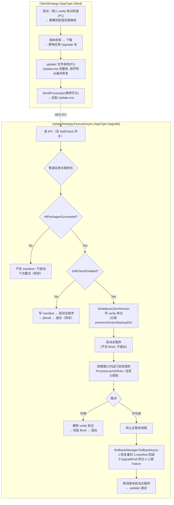

# 自检功能（Self-Check）设计方案

> **目标：** 为 Client（主程序）与 Updater（升级程序）添加"自检 + 自检开关"，在更新完成后验证应用自身是否可用；一旦发现更新后的版本不可用，自动回滚到上一个可用版本，保证用户手里始终有一个能用的程序。

> **阅读前置：** 建议 先读 [core-execution-flow.md](core-execution-flow.md) 第 1、3、10、13 节，理解 Client/Upgrade 双进程模型与现有错误恢复机制。

---

## 目录

1. [背景与问题](#1-背景与问题)
2. [现状能力与缺口分析](#2-现状能力与缺口分析)
3. [总体设计](#3-总体设计)
4. [自检开关设计](#4-自检开关设计)
5. [自检规则与执行引擎](#5-自检规则与执行引擎)
6. [Updater 侧自检（主流程闭环）](#6-updater-侧自检主流程闭环)
7. [Client 侧自检](#7-client-侧自检)
8. [回滚设计（RollbackManager）](#8-回滚设计rollbackmanager)
9. [完整流程图](#9-完整流程图)
10. [文件改动清单](#10-文件改动清单)
11. [兼容性分析](#11-兼容性分析)
12. [测试计划](#12-测试计划)
13. [分期实施计划](#13-分期实施计划)

---

## 1. 背景与问题

GeneralUpdate 现有的失败处理集中在**更新过程本身**（下载失败、哈希不匹配、解压/补丁失败），并以 `AllPackagesSucceeded` 作为闸门决定是否写回 manifest、是否启动主程序。

但"**管道全部成功 ≠ 应用可用**"。以下场景中，现有机制全部失效，应用会停留在坏版本上：

| # | 场景 | 现状结果 |
|---|------|---------|
| S1 | 新版本主程序启动即崩溃（缺依赖、配置不兼容、补丁合成的二进制损坏） | 管道成功 → manifest 已推进到坏版本 → updater 启动坏程序后退出 → 用户每次启动都是崩溃的坏版本，且服务端无更多更新可推，**永久卡死** |
| S2 | 版本链中 1.0.1 应用成功、1.0.2 应用失败 | `TryRollback()` 只在"本批次尚无任何版本成功"时触发（`AbstractStrategy.ExecuteAsync`），混合状态下不回滚 → 安装目录处于新旧混杂的不一致状态 |
| S3 | Upgrade 包（updater 自身）原地升级后 `Update.exe` 损坏 | Client 下次 `Process.Start(Update.exe)` 抛异常，事件上报后无恢复动作 → 本次主程序更新中断（主程序旧版本尚可用，但更新链路瘫痪） |
| S4 | `BackupEnabled` 默认 `false`（`Option.BackupEnabled` 默认值） | 多数用户实际没有备份，出问题时无回滚材料 |

自检功能要填补的正是这一段：**从"文件替换完成"到"应用确认可用"之间的验证空白，以及验证失败后的自动回滚闭环。**

---

## 2. 现状能力与缺口分析

### 2.1 可复用的现有设施

| 设施 | 位置 | 在本设计中的角色 |
|------|------|----------------|
| `Option<T>` 注册表 + `SetOption`/`GetOption` | `Configuration/Option.cs` | 自检开关的载体（如 `PatchEnabled`/`BackupEnabled` 的同款模式） |
| `StorageManager.Backup/Restore/GetLatestBackup` | `FileSystem/StorageManager.cs` | 回滚的文件恢复执行器（现成能力） |
| `ManifestInfo.TryUpdateVersion` | `Configuration/ManifestInfo.cs` | 回滚时把 `ClientVersion`/`UpgradeClientVersion` 写回旧版本 |
| `Environments.Set/GetEnvironmentVariable("UpgradeFail")` | `Configuration/Environments.cs` + `ClientStrategy.CheckFail()` | 标记"已知失败版本"，`CheckFail` 已有读取逻辑，**防止再次升级到坏版本** |
| `IUpdateReporter` + `UpdateStatus(1/2/3)` | `Download/Reporting/IUpdateReporter.cs` | 自检失败上报 `Failure`，无需服务端协议变更 |
| `ProcessContract` AES 加密文件 IPC | `Configuration/ProcessContract.cs` | 把自检开关从 Client 传递到 Updater |
| `GracefulExit.ShutdownAsync` | `GracefulExit.cs` | 自检失败后终止残留的主程序进程 |
| `AbstractBootstrap` 扩展点机制 | `Configuration/AbstractBootstrap.cs` | 注册自定义自检规则 |
| `GeneralUpdate.Bowl`（procdump 崩溃守护） | `GeneralUpdate.Bowl/*` | Windows-only 的被动崩溃监测 + 备份恢复，与本设计互补（见 2.3） |

### 2.2 缺口

1. **没有"启动验证"环节**：更新后主程序第一次启动是否成功，无人验证。
2. **`TryRollback` 条件过窄**：仅当批次内零成功时触发；且它发生在 updater 管道阶段，覆盖不了"启动阶段才发现的失败"。
3. **`UpgradeFail` 有读无写**：`ClientStrategy.CheckFail()` 读取该标记，但全仓库**没有任何代码写入它**（`BowlContext` 文档声称 Bowl 崩溃时会写，实际未实现）——"防止重复升级到坏版本"的机制事实上处于断链状态。
4. **Bowl 不是完整答案**：Windows-only、依赖 procdump 工具链、需要外部正确传入 `WorkModel=Upgrade + AutoRestore + BackupDirectory`；且它是被动等崩溃，不是主动验证。Linux/macOS 完全没有守护。

### 2.3 与 Bowl 的关系

自检（Self-Check）与 Bowl 定位互补，不互相替代：

| 维度 | Self-Check（本设计） | Bowl |
|------|---------------------|------|
| 检测时机 | 更新完成后**主动**验证 | 运行期**被动**监听崩溃 |
| 平台 | Windows / Linux / macOS | Windows（依赖 procdump） |
| 依赖 | 无外部工具 | procdump 工具链 |
| 动作 | 验证失败 → 回滚 + 换回旧版启动 | 崩溃 → 抓 dump + 诊断 + 可选恢复备份 |
| 裁决方 | Updater 进程（观察窗口内裁决） | procdump 子进程 |

开启 Self-Check 时，观察窗口期间**不启动 Bowl**，由 updater 独立裁决；自检通过后再按现有逻辑拉起 Bowl，行为不变。

---

## 3. 总体设计

### 3.1 一句话架构

> **Updater 是自检的裁决者与回滚的执行者**：更新应用完成后，updater 启动主程序并在观察窗口内验证其可用性；不可用 → 终止进程 → 恢复备份 → 回退 manifest → 标记失败版本 → 上报 → 用旧版本重新启动主程序。Client 侧负责配置开关（经 IPC 传递）、拉起 updater 前对 updater 自身做文件级自检，以及主程序启动路径上的兜底恢复。

```
┌─────────────────────────── Client 进程 (MyApp.exe, AppType.Client) ───────────────────────────┐
│  启动兜底自检: 检测上次更新遗留的 verify 标记 → 需要时回滚（第三道防线, P1）                    │
│  版本校验 → 下载 → 原地应用 Upgrade 包                                                          │
│  Updater 自检: Update.exe 存在/完整, 损坏则从备份恢复 (ClientStrategy)                          │
│  SendProcessIpc( 携带 SelfCheck 开关 ) → 拉起 Update.exe → 退出                                 │
└──────────────────────────────────────────────┬────────────────────────────────────────────────┘
                                               │ AES IPC
┌─────────────────────────── Updater 进程 (Update.exe, AppType.Upgrade) ────────────────────────┐
│  读 IPC（含开关） → 应用主程序更新包（管道, 现有失败处理不变）                                    │
│  AllPackagesSucceeded?                                                                         │
│    ├─ No  → 不写 manifest / 不启动（现状）                                                      │
│    └─ Yes → SelfCheck 开关?                                                                    │
│         ├─ Off → 写 manifest → 启动主程序 → 退出（现状）                                         │
│         └─ On → 写 verify 标记(记录 previousVersion/backupDir/targetVersion)                    │
│              → 写 manifest → 启动主程序 → 观察窗口内裁决                                         │
│                   ├─ 可用   → 清理标记 → (拉起 Bowl) → 退出                                      │
│                   └─ 不可用 → 杀进程 → RollbackManager:                                         │
│                        恢复备份 → 回退 manifest → UpgradeFail 标记                              │
│                        → 上报 Failure → 用旧版本启动主程序 → 退出                                │
└───────────────────────────────────────────────────────────────────────────────────────────────┘
```

### 3.2 设计原则

1. **开关默认关闭**（`SelfCheckEnabled` 默认 `false`）：不开启时全部行为与现状完全一致，零风险。
2. **回滚的执行者必须有可执行副本**：主程序运行中无法替换自身（Windows 文件锁），因此验证-回滚闭环放在 updater 进程内完成——失败发生时主程序刚被拉起、尚未深入运行，updater 拥有进程控制权与文件操作权。
3. **复用而非重建**：备份恢复、manifest 回写、失败上报、版本拦截全部复用现有组件；`UpgradeFail` 写入方在本设计中补齐。
4. **验证分层，可插拔**：内置规则解决"能不能启动"（框架能做的），应用层健康确认通过规则扩展点交给宿主（只有业务自己知道什么算"可用"）。
5. **IPC 契约向后兼容**：`ProcessContract` 只增字段，旧端忽略新字段、新端对旧数据取默认值。

---

## 4. 自检开关设计

### 4.1 Option 定义（`Configuration/Option.cs` 新增）

```csharp
/// 总开关。false = 全部行为与现状一致。
/// bool? 语义与 PatchEnabled/BackupEnabled 一致：??= 保留 IPC 传入值。
public static Option<bool?> SelfCheckEnabled { get; } = ValueOf<bool?>("SELFCHECKENABLED", false);

/// 进程启动观察窗口（秒）。启动后在该窗口内裁决主程序是否可用。
public static Option<int> SelfCheckStartupWindowSeconds { get; } = ValueOf<int>("SELFCHECKSTARTUPWINDOWSECONDS", 30);

/// (P1) 严格模式：要求主程序在窗口内写入 verify-ok 应答，超时未应答视为失败。
/// 默认宽松：窗口内进程存活即视为可用。
public static Option<bool> SelfCheckRequireAck { get; } = ValueOf<bool>("SELFCHECKREQUIREACK", false);
```

### 4.2 配置流转（UpdateContext / ProcessContract）

`UpdateContext` 新增：

```csharp
public bool? SelfCheckEnabled { get; set; }
public int SelfCheckStartupWindowSeconds { get; set; } = 30;
```

`ProcessContract` 新增（属性追加 + `ConfigurationMapper.MapToProcessContract` 末尾对象初始化器赋值，模式同 `ReportType`，避免改动 23 参数的构造函数签名）：

```csharp
[JsonPropertyName("SelfCheckEnabled")]
public bool? SelfCheckEnabled { get; set; }

[JsonPropertyName("SelfCheckStartupWindowSeconds")]
public int SelfCheckStartupWindowSeconds { get; set; } = 30;
```

配置优先级（两侧一致，沿用 `ApplyRuntimeOptions` 的现有惯例）：

```
用户显式 SetOption(Option.SelfCheckEnabled, x)
        > IPC 传入值（仅 updater, InitializeFromEnvironment 填充）
        > 默认值 false
```

- Client 侧：`GeneralUpdateBootstrap.ApplyRuntimeOptions()` 中 `_configInfo.SelfCheckEnabled ??= GetOption(Option.SelfCheckEnabled)`。
- Updater 侧：`InitializeFromEnvironment()` 从 `ProcessContract` 回填 `_configInfo.SelfCheckEnabled`；`ApplyRuntimeOptions` 用 `??=` 不覆盖。用户在 updater 宿主代码里显式 `SetOption` 仍然优先（`SelfCheckEnabled` 为非空引用类型判断与现有 `PatchEnabled` 完全同型）。

### 4.3 开关与备份的联动规则

自检失败→回滚依赖备份存在。规则：

- `SelfCheckEnabled == true` 且 `BackupEnabled` 未被用户显式设置时，**自动置 `BackupEnabled = true`**，并写 Info 日志说明（`_configInfo.BackupEnabled ??= true`）。
- 用户显式 `SetOption(Option.BackupEnabled, false)` = **降级模式**：自检照常执行、失败照常上报与标记 `UpgradeFail`，但**跳过文件回滚与旧版重启**（无备份材料，不能凭空恢复），日志 Warn 提示。

---

## 5. 自检规则与执行引擎

新增命名空间 `GeneralUpdate.Core.SelfCheck`（位于 GeneralUpdate.Core，client/updater 双端共用）。

### 5.1 核心类型

```csharp
/// 自检上下文——一次自检会话的全部输入。
public sealed record SelfCheckContext(
    string InstallPath,        // 安装根目录
    string AppName,            // 被验证的可执行文件名（如 MyApp.exe）
    string? TargetVersion,     // 本次更新到的版本
    string? PreviousVersion,   // 回滚目标版本（更新前版本）
    string? BackupDirectory,   // 本次更新对应的备份目录
    Configuration.AppType Role,// Client / Upgrade（谁在被验证）
    string? VerifyMarkerPath); // verify 标记文件路径（含则规则可读写协作文件）

/// 单条规则的结论。
public sealed record SelfCheckRuleResult(string RuleName, bool Passed, string? Detail);

/// 自检报告（全部规则的聚合）。
public sealed record SelfCheckReport(bool Passed, IReadOnlyList<SelfCheckRuleResult> Results)
{
    public string? FirstFailureReason => Results.FirstOrDefault(r => !r.Passed)?.Detail;
}

/// 规则扩展点——宿主可实现并注册自定义健康检查。
public interface ISelfCheckRule
{
    string Name { get; }
    Task<SelfCheckRuleResult> CheckAsync(SelfCheckContext ctx, CancellationToken ct);
}
```

### 5.2 内置规则

**`ProcessLaunchRule`（核心规则，P0）** — "应用能不能启动并存活"

```
1. Process.Start(InstallPath/AppName)          // 启动失败(FileNotFound/Win32Exception) → 失败
2. 在 StartupWindow 窗口内 WaitForExitAsync 轮询：
   ├─ 进程退出且 ExitCode != 0                 → 失败（启动即崩溃）
   ├─ 进程退出且 ExitCode == 0                 → 通过*（CLI 型主程序正常结束；记入报告）
   ├─ 窗口超时且进程仍存活                     → 通过（默认宽松策略）
   ├─ (RequireAck=true) 窗口内出现 verify-fail → 失败（应用自报不健康）
   └─ (RequireAck=true) 窗口超时且无 verify-ok → 失败（未确认 = 不可用）
3. 裁决为失败时：GracefulExit.ShutdownAsync(process) 清理残留进程
```

\* ExitCode==0 的语义在报告中如实记录（`Detail`），便于排查"闪退但退出码为 0"的少数场景；不作为失败处理以兼容控制台型主程序。

**`FilePresenceRule`（辅助规则，P0）** — 关键文件存在且非空

```csharp
public class FilePresenceRule : ISelfCheckRule
{
    // criticalFiles: 相对 InstallPath 的路径，如 "MyApp.exe", "config/appsettings.json"
    // 来源：默认取 MainAppName 单项；宿主可注册多份关键文件清单
    public FilePresenceRule(params string[] criticalFiles) { ... }
    // Check: File.Exists && length > 0，任一缺失/为空 → 失败
}
```

**`AckFileRule`（应用层协作协议，P1）** — 见第 6.4 节。

### 5.3 执行引擎 `SelfCheckRunner`

```csharp
public sealed class SelfCheckRunner
{
    public SelfCheckRunner(IEnumerable<ISelfCheckRule> rules);
    public async Task<SelfCheckReport> RunAsync(SelfCheckContext ctx, CancellationToken ct);
    // 逐条顺序执行；单条规则抛异常 = 该规则失败（Detail=异常消息），不中断其余规则 —— 与 hooks 的 Safe 包装惯例一致
}
```

### 5.4 Bootstrap 注册扩展（`AbstractBootstrap` 新增）

现有 `ResolveExtension` 是"接口→单实现"语义，规则是集合语义，因此新增独立列表：

```csharp
private readonly List<Func<ISelfCheckRule>> _selfCheckRuleFactories = new();

/// 注册自定义自检规则（可多次调用，顺序执行）。
public TBootstrap SelfCheckRule<T>() where T : ISelfCheckRule, new()
{
    _selfCheckRuleFactories.Add(() => new T());
    return (TBootstrap)this;
}
// GeneralUpdateBootstrap.ConfigureStrategy() 中把列表注入 ClientStrategy / UpdateStrategy
// （UpdateStrategy 需要新增 SetSelfCheckRules(...)，模式同 SetDiffPipeline）
```

用法示例：

```csharp
var result = await new GeneralUpdateBootstrap()
    .SetSource("https://api.example.com", "my-key")
    .SetOption(Option.AppType, AppType.Upgrade)
    .SetOption(Option.SelfCheckEnabled, true)                  // ← 开关
    .SetOption(Option.SelfCheckStartupWindowSeconds, 60)       // ← 可选调参
    .SelfCheckRule<MyDbHealthRule>()                           // ← 可选自定义规则
    .LaunchAsync();
```

---

## 6. Updater 侧自检（主流程闭环）

这是整个功能的**核心闭环**：验证失败 → 自动回到上一个可用版本。

### 6.1 `UpdateStrategy.ExecuteAsync()` 的改动点

现状（`Strategy/UpdateStrategy.cs:94-187`）管道成功后依次：写回 manifest → OnAfterUpdate 钩子 → 上报 Success → OnBeforeStartApp 钩子 → `StartAppAsync()`（内部启动主程序 + Bowl + updater 自我退出）。

改动后的分支：

```csharp
if (pipelineSucceeded)
{
    if (_configInfo.SelfCheckEnabled == true && _configInfo.LaunchClientAfterUpdate)
    {
        await ExecuteVerifiedLaunchAsync(ctx);   // ← 新路径（下文）
    }
    else
    {
        WriteBackClientVersion();
        // ... 现状流程原样保留 ...
    }
}
```

### 6.2 `ExecuteVerifiedLaunchAsync` 流程（新方法）

```
1. WriteBackClientVersion()                        // 先推进 manifest（与现状一致；失败由回滚负责撤回）
2. UpdateVerificationMarker.Write(installPath,     // 写 verify 标记（JSON, AOT source-gen context）
       targetVersion, previousVersion: _configInfo.CurrentVersion,
       backupDirectory, state: Launched)
3. SafeOnBeforeStartAppAsync(ctx)                  // 保留钩子（chmod 等）
4. var process = abs.StartProcessForVerification(MainAppName)
       // 新增内部方法：仅 Process.Start 返回进程对象，不拉 Bowl、不自我退出
       // （复用 AbstractStrategy.ResolveAppPath 路径解析）
5. report = selfCheckRunner.RunAsync(new SelfCheckContext(...), ct)
       // ProcessLaunchRule 在窗口内观察（规则内部持有 process 引用）
6. report.Passed?
   ├─ Yes → Marker.Delete() → (可选) 拉起 Bowl → 上报维持 Success → updater 正常退出（GracefulExit.CurrentProcessAsync）
   └─ No  → 残留进程清理（规则已做）→
       RollbackManager.RollbackAsync(new RollbackRequest(
           failedVersion: targetVersion, previousVersion, backupDirectory,
           recordId: UpdateVersions.First().RecordId, reportType, reason: report.FirstFailureReason))
       → 用旧版本启动主程序：abs.StartProcess(MainAppName)（文件已回到旧版）
       → SafeOnUpdateErrorAsync + 上报 Failure（RollbackManager 内部已报，此处补钩子/事件）
       → updater 退出
```

要点：

- **观察窗口期间不启动 Bowl**，避免 procdump 与 updater 双方对同一崩溃重复裁决；自检通过后再按 `LaunchBowl=true` 拉起。
- **`LaunchClientAfterUpdate == false`**（维护窗口/静默暂存场景）时没有可验证的启动动作，跳过运行时验证、**不写 verify 标记**，走现状路径（P1 再考虑"下次首启验证"）。
- **管道本身就失败**（`pipelineSucceeded == false`）时维持现状：不写 manifest、不启动、下次重试。这属于"更新失败"，不是"更新成功但应用不可用"，不在自检范围内；现有 `TryRollback` 已覆盖零成功场景。

### 6.3 verify 标记文件（`generalupdate.verify.json`）

存放于 `InstallPath`，与 `generalupdate.manifest.json` 同级：

```json
{
  "schema": 1,
  "targetVersion": "1.0.2",
  "previousVersion": "1.0.1",
  "backupDirectory": "D:/app/.backups/backup-20261018120000",
  "createdAtUtc": "2026-10-18T04:00:00Z",
  "state": "Launched"
}
```

生命周期**完全由 updater 管理**：启动前写入（`Launched`）→ 裁决后删除（通过）或就地回滚（失败）。正常路径下标记文件存活时间 = 观察窗口（默认 30s）。它的存在也让 P1 的 Client 兜底防线有了判断依据（见 7.3）。

新增 `JsonContext/UpdateVerificationMarkerJsonContext.cs` source-gen context（AOT 兼容，模式同现有各 JsonContext）。

### 6.4 应用层健康确认协议（P1，`RequireAck` 模式）

"能启动"之外，只有业务自己知道什么算"可用"（DB 连通、License 有效、核心服务就绪）。约定文件协议，无需额外 IPC 通道：

- updater 写入 verify 标记后，主程序在**启动早期**检测到该文件（`SelfCheckContext.VerifyMarkerPath` 由框架提供查询 API），完成业务自检后：
  - 健康 → 同目录写 `generalupdate.verify.ok`
  - 不健康 → 写 `generalupdate.verify.fail`（内容为原因 JSON）
- `RequireAck=false`（默认）：宽松，进程存活即通过——兼容不集成确认协议的宿主。
- `RequireAck=true`：严格，窗口内必须出现 `.ok`；出现 `.fail` 或超时未确认 → 判定失败 → 回滚。

框架提供便捷 API（供主程序调用）：

```csharp
public static class UpdateSelfCheck
{
    /// 主程序启动时调用：当前处于"更新后待确认"状态则返回上下文，否则 null。
    public static PendingVerification? GetPendingVerification(string installPath);
    /// 报告业务自检结论（写 .ok / .fail）。
    public static void ReportHealth(string installPath, bool healthy, string? reason = null);
}
```

---

## 7. Client 侧自检

Client 的自检对象有两个：**updater 自身**（它也是被更新物）与**主程序自身的兜底恢复**。

### 7.1 拉起 updater 前的文件级自检（P1，`ClientStrategy.LaunchUpgradeProcessAsync`）

对应场景 S3：Upgrade 包刚被原地应用到 updater 目录，若 `Update.exe` 损坏，`Process.Start` 会失败。

```
LaunchUpgradeProcessAsync():
  1. updaterPath = ResolveAppPath(UpdateAppName, UseUpdatePath)
  2. UpdaterIntegrityCheck(updaterPath):
       存在 && 大小 > 0 && (可选) PE/Mach-O/ELF 魔数与当前平台匹配
  3. 通过 → 现状流程
     失败 && 本会话应用过 Upgrade 包 →
       从最近备份恢复 updater 文件（StorageManager.Restore 定向到 UpdatePath 子树）
       → 重新检查 → 通过则继续；仍失败 →
       上报 Failure + 事件 + Trace，跳过拉起（主程序旧版本继续运行，本次主程序更新留待下次）
```

覆盖场景 S3 的另一半：若 Client 进程内 `ApplyUpgradePackagesAsync` 之后、拉起之前 updater 已坏，这里兜住；若拉起本身抛异常（现有 catch 已捕获），在 catch 中追加同样的"备份恢复 + 一次重试"动作。

### 7.2 主程序自身启动自检（P1，可插拔）

主程序是自检的最终受益者，但它的验证闭环在 updater 内已完成（第 6 节）。Client 侧再提供一道**兜底**，覆盖"updater 自身中途被杀、标记未被清理"的孤儿场景：

```
ClientStrategy.ExecuteAsync() 入口（CallSmallBowlHomeAsync 之后）:
  marker = UpdateVerificationMarker.TryRead(installPath)
  if marker != null && marker 处于 Launched 状态（updater 没来得及裁决）:
      → 记录 Warn + 执行 RollbackManager 回滚（材料都在标记里）→ 删除标记
      → 本次以回滚后的版本继续执行常规更新检查
```

> **风险控制**：孤儿标记也可能来自"用户手动杀了 updater"而非"主程序不可用"。P1 实现时对超过 `24h` 的标记只清理不回滚（认为已过窗口期，避免凭空降级）；窗口期内的孤儿标记才执行回滚。该防线默认随 `SelfCheckEnabled` 启用。

### 7.3 静默模式（SilentPollOrchestrator）

静默模式只是延迟了拉起 updater 的时机（`ProcessExit` → `LaunchUpgradeProcessSync`），自检开关经 IPC 随契约传递，**updater 侧闭环自动生效，无需改动**。仅 7.1 的 updater 文件自检需要在 `LaunchUpgradeProcessSync` 内同样接入（与 `LaunchUpgradeProcessAsync` 共用同一检查方法）。

---

## 8. 回滚设计（RollbackManager）

新增 `SelfCheck/RollbackManager.cs`，把分散的恢复动作收拢为单一入口（updater 自检失败、Client 兜底防线共用）：

```csharp
public sealed record RollbackRequest(
    string FailedVersion,       // 判定为不可用的版本
    string? PreviousVersion,    // 回滚目标版本
    string? BackupDirectory,    // 本 次 更 新 对 应 的 备 份 目 录
    int RecordId,               // 上报用
    int ReportType,
    string Reason);

public sealed record RollbackResult(
    bool FilesRestored,         // 文件是否恢复成功
    bool ManifestReverted,      // manifest 是否回退成功
    string? ActiveVersion);     // 回滚后实际生效的版本

public sealed class RollbackManager
{
    public RollbackManager(string installPath, Download.Reporting.IUpdateReporter reporter);

    public async Task<RollbackResult> RollbackAsync(RollbackRequest req, CancellationToken ct);
}
```

`RollbackAsync` 执行序（每步独立 try-catch，单步失败不阻断后续，全部记 Trace）：

```
1. 解析备份目录：req.BackupDirectory 优先（verify 标记中记录），
   不存在则 StorageManager.GetLatestBackup(installPath) 兜底
2. StorageManager.Restore(backupDir, installPath)          // 文件恢复（现有能力）
3. ManifestInfo.TryUpdateVersion(installPath,
       clientVersion: req.PreviousVersion)                 // 版本回退（NextUpdate 从旧版本重新计算）
   ↑ previousVersion 为空时跳过（无法确定目标版本，仅恢复文件）
4. Environments.SetEnvironmentVariable("UpgradeFail", req.FailedVersion)
   // ★ 补齐现状断链：ClientStrategy.CheckFail() 已有读取端，
   //   下次更新目标 <= 失败版本 时直接终止，防止反复装回坏版本
5. Reporter.ReportAsync(new UpdateReport(req.RecordId, (int)UpdateStatus.Failure, req.ReportType))
6. 返回 RollbackResult；调用方（updater）负责用旧版本重新启动主程序
```

设计要点：

- **`UpgradeFail` 拦截的是"同版本重复失败"**，不影响服务端后续发布更高版本（`CheckFail` 条件为 `failVersion >= targetVersion`，见 `ClientStrategy.CheckFail()`）；服务端修复后发布 1.0.3，客户端可正常升级到 1.0.3。
- **多链版本回滚粒度**：一次批量更新 1.0.1→1.0.3 时，失败即整链回滚到更新前的 `previousVersion`（备份是更新前全量快照，天然支持），不做链中部分回滚——与 `TryRollback` 的保守哲学一致，避免混合状态（场景 S2 的根治）。
- **回滚本身失败的极端情况**：文件恢复失败时安装目录可能不一致，此时**不再启动主程序**（避免以坏状态运行），保持现状的错误上报 + 事件路径，由运维介入。这与现有 `TryRollback` 失败仅记日志相比是一处明确的行为增强。

---

## 9. 完整流程图



---

## 10. 文件改动清单

### 新增（GeneralUpdate.Core）

| 文件 | 内容 |
|------|------|
| `SelfCheck/ISelfCheckRule.cs` | 规则接口 + `SelfCheckContext`/`SelfCheckRuleResult`/`SelfCheckReport` |
| `SelfCheck/ProcessLaunchRule.cs` | 进程启动观察规则（内置） |
| `SelfCheck/FilePresenceRule.cs` | 关键文件存在性规则（内置） |
| `SelfCheck/AckFileRule.cs` | (P1) 应用层确认协议规则 |
| `SelfCheck/SelfCheckRunner.cs` | 执行引擎 |
| `SelfCheck/UpdateVerificationMarker.cs` | verify 标记读写 + `UpdateSelfCheck` 宿主 API |
| `SelfCheck/RollbackManager.cs` | 回滚执行器 |
| `JsonContext/UpdateVerificationMarkerJsonContext.cs` | AOT source-gen 序列化上下文 |

### 修改（GeneralUpdate.Core）

| 文件 | 改动 |
|------|------|
| `Configuration/Option.cs` | +3 个 Option 键（4.1 节） |
| `Configuration/UpdateContext.cs` | +`SelfCheckEnabled`、`SelfCheckStartupWindowSeconds` |
| `Configuration/ProcessContract.cs` | +2 个 IPC 字段（只增不改） |
| `Configuration/ConfigurationMapper.cs` | `MapToProcessContract` 尾部初始化新字段 |
| `Bootstrap/GeneralUpdateBootstrap.cs` | `ApplyRuntimeOptions` 读取开关；`InitializeFromEnvironment` 回填 IPC 值；开关联动备份 |
| `Configuration/AbstractBootstrap.cs` | +`SelfCheckRule<T>()` 注册与规则列表 |
| `Strategy/UpdateStrategy.cs` | +`ExecuteVerifiedLaunchAsync` 验证启动路径；接收自检规则 |
| `Strategy/ClientStrategy.cs` | (P1) updater 完整性检查接入两处拉起路径；入口孤儿标记兜底 |
| `Bootstrap/GeneralUpdateBootstrap.cs`（事件） | +`AddListenerSelfCheckCompleted(SelfCheckCompletedEventArgs)` |

### 不改动

- `AbstractStrategy.TryRollback` / 管道阶段错误处理 —— 保持现状（更新期失败与启动期自检是两个阶段，互不侵入）。
- `GeneralUpdate.Bowl` —— 保持独立；P2 可考虑让 Bowl 崩溃路径复用 `RollbackManager` 与 `UpgradeFail` 写入（顺带修复 Bowl 文档与实现不一致的问题）。
- 服务端协议 —— 复用 `UpdateStatus(1/2/3)`，无变更。

---

## 11. 兼容性分析

| 组合 | 行为 |
|------|------|
| 新 Client + 新 Updater，开关关 | 与现状逐字节一致（默认 `false`） |
| 新 Client + 旧 Updater，开关开 | 旧 updater 反序列化 IPC 时忽略新字段 → 走现状（无自检）。Client 侧日志 Warn 提示 updater 版本过旧不支持自检 |
| 旧 Client + 新 Updater | IPC 无新字段 → `SelfCheckEnabled == null` → 走现状 |
| `netstandard2.0` 目标 | 新代码仅用 `Process`/`File`/`Task` 等 netstandard2.0 可用 API；观察窗口用 `WaitForExitAsync` 的 polyfill（轮询 `HasExited` + `Task.Delay`），不依赖 .NET 5+ 独有 API |
| NativeAOT | 标记文件走 source-gen JsonContext；无反射 |

---

## 12. 测试计划

新增 `tests/CoreTest/SelfCheck/`（沿用现有 xUnit + 临时目录集成测试风格，参考 `BackupRestoreTests`）：

| 测试组 | 覆盖点 |
|--------|--------|
| `UpdateVerificationMarkerTests` | 标记写/读/删、损坏 JSON 容错、孤儿标记超龄判定 |
| `SelfCheckRunnerTests` | 规则聚合、单规则异常不中断、报告 FirstFailureReason |
| `FilePresenceRuleTests` | 缺失 / 空文件 / 全通过 |
| `ProcessLaunchRuleTests` | 用 `dotnet` 子进程模拟：立即 Exit(1) → 失败；存活超窗口 → 通过；启动不存在文件 → 失败 |
| `RollbackManagerTests` | 备份恢复、manifest 回退、`UpgradeFail` 写入且 `CheckFail` 可读回、无备份时降级、单步失败不阻断 |
| `UpdateStrategySelfCheckTests` | 开关矩阵：On/Off × 管道成功/失败 × 验证通过/失败，断言 manifest、标记、上报、启动行为 |
| `ProcessContractSelfCheckTests` | 新字段序列化；旧 JSON（无新字段）反序列化 = null/false 兼容 |

手工验收场景（E2E）：

1. 正常更新 + 自检开 → 更新成功、标记被清理、无回滚痕迹。
2. 主程序包内放置启动即 `Environment.Exit(-1)` 的桩程序 → 自检判负 → 目录回滚为旧版 → 旧版被重新启动 → 服务端收到 Failure → 再次触发更新时被 `UpgradeFail` 拦截。
3. `RequireAck` 模式下主程序写 `.fail` → 回滚。
4. `BackupEnabled=false` 显式覆盖 → 自检失败仅上报不回滚（降级路径）。

---

## 13. 分期实施计划

| 阶段 | 内容 | 交付判据 |
|------|------|---------|
| **P0（MVP）** | Option/IPC 开关链路；`ProcessLaunchRule` + `SelfCheckRunner`；verify 标记；`RollbackManager`；`UpdateStrategy` 验证启动路径；上报与事件；文档 | E2E 场景 1/2 通过，开关关闭时全部现有测试不回归 |
| **P1** | `RequireAck` 协议与 `AckFileRule`；Client 侧 updater 完整性自检（两处拉起路径）；主程序入口孤儿标记兜底防线 | E2E 场景 3/4 通过 |
| **P2** | Bowl 崩溃路径复用 `RollbackManager` + 补齐 `UpgradeFail` 写入（修复文档与实现不一致）；自检遥测细节上报；`MaxChainBeforeFallback` 场景下链式更新的回滚粒度实测调优 | — |

---

## 附：与现有失败处理的职责边界

```
┌────────────────┬──────────────────────────────┬─────────────────────────────────┐
│    阶段         │  失败含义                     │  处理者（现状 → 自检后）          │
├────────────────┼──────────────────────────────┼─────────────────────────────────┤
│ 下载 / 校验     │  包拿不到或损坏               │  ClientStrategy（现状, 不变）     │
│ 管道应用        │  文件替换失败                 │  AbstractStrategy.TryRollback    │
│                │                              │  （现状, 不变）                   │
│ 启动验证        │  文件替换成功但应用不可用      │  ★ 新增: SelfCheck + Rollback    │
│                │                              │    Manager（本设计核心）          │
│ 运行期崩溃      │  运行一段时间后崩溃           │  Bowl（Windows, 现状不变）；       │
│                │                              │  P2 与 RollbackManager 打通       │
└────────────────┴──────────────────────────────┴─────────────────────────────────┘
```
